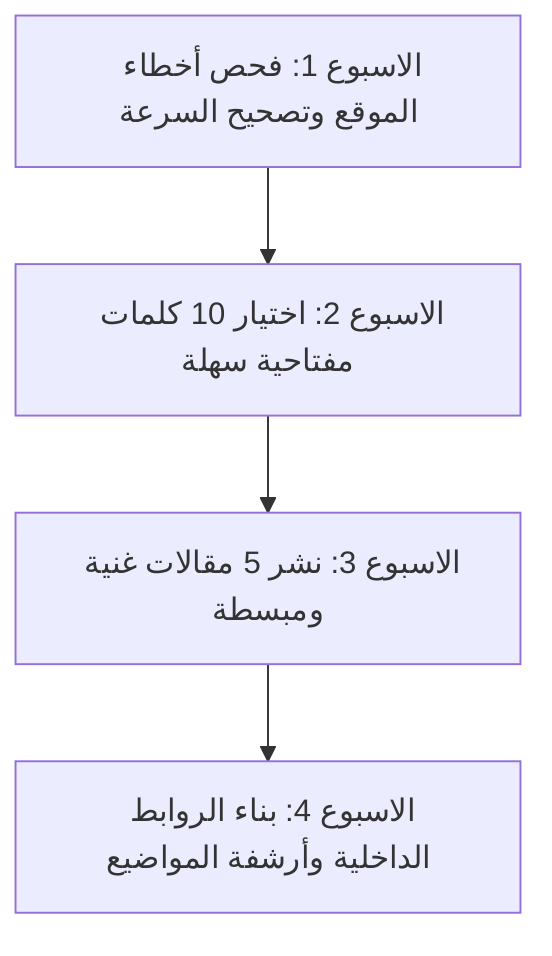

# كيف تضاعف زيارات موقعك 300% باستخدام أدوات SEO مجانية تعتمد على الذكاء الاصطناعي

هل تمتلك مدونة أو متجراً إلكترونياً وتجد صعوبة في جذب الزوار المجانيين من محرك بحث جوجل؟ الاشتراكات المرتفعة لأدوات مثل Ahrefs أو SEMrush (والتي تتجاوز 120$ شهرياً) تضع عائقاً كبيراً أمام أصحاب المواقع الجدد.

لكن الخبر السار هو أن ثورة الذكاء الاصطناعي والأدوات المجانية المتاحة في 2026 تمكنك من تنفيذ خطة سيو (SEO) كاملة ومحترفة تتغلب بها على منافسيك بدون إنفاق أي دولار!

---

## 1. استخراج الكلمات المفتاحية الذكية مجاناً (Keyword Research)

بدلاً من الاعتماد على التخمين، يمكنك استخراج نية البحث الحقيقية (Search Intent) والكلمات المفتاحية ذات المنافسة المنخفضة وحجم البحث العالي باستخدام الجمع بين:

- **Google Search Console**: مصدر البيانات الأول الدقيق لموقعك لمعرفة الكلمات التي تظهر فيها حالياً وتعمل على تحسينها.
- **Google Keyword Planner**: أداة جوجل المجانية للحصول على حجم البحث الدقيق.
- **Prompt التوليد الذكي عبر Claude أو ChatGPT**:

> "أنا أدير موقعاً تقنياً مختصاً بالأتمتة. اقترح عليّ 10 كلمات مفتاحية طويلة الذيل (Long-tail keywords) في مجال n8n والذكاء الاصطناعي تكون المنافسة عليها منخفضة وتلبي نية القارئ الباحث عن الحلول المجانية."

---

## 2. تحسين البنية البرمجية والسيو التقني (Technical SEO)

محركات البحث تعشق المواقع السريعة والمنظمة. اتبع الخطوات التالية مجاناً:

### أ) تسريع تحمّيل الصور (WebP Image Optimization)

قم بتحويل كافة صور الموقع إلى صيغة `WebP` واستخدام أبعاد محسنة لمنع ضياع سرعة التحميل على الهواتف.

### ب) إضافة Schema Structured Data تلقائياً

استخدم نماذج الذكاء الاصطناعي لتوليد كود `JSON-LD` المخصص للأسئلة الشائعة والمقالات حتى تظهر بمربعات الإجابة المباشرة على جوجل (Rich Snippets).

```json
{
  "@context": "https://schema.org",
  "@type": "FAQPage",
  "mainEntity": [
    {
      "@type": "Question",
      "name": "كيف أحصل على رصيد مجاني في أدوات الذكاء الاصطناعي؟",
      "acceptedAnswer": {
        "@type": "Answer",
        "text": "يمكنك التسجيل في Google AI Studio وGroq Cloud للحصول على وصول مجاني دائم دون استخدام بطاقة بنكية."
      }
    }
  ]
}
```

## فيديو المرئي لأساسيات تحسين السيو بالذكاء الاصطناعي

شاهد في هذا الفيديو الشامل كيفية تصدر محركات البحث وجلب آلاف الزوار مجاناً:

@[youtube](https://www.youtube.com/watch?v=14QRE4_N9b4)

---

## 3. كتابة محتوى يتطابق مع معايير Google E-E-A-T

تضمن معايير جوجل الحديثة (الخبرة، الكفاءة، المصداقية، والموثوقية) عدم تصدر المقالات الإنشائية الضعيفة.

### كيفية صياغة مقال يتصدر محرك البحث:

1. **مقدمة مباشرة**: تجنب المقدمات الطويلة وابدأ بالحل فوراً.
2. **عناوين فرعية H2 و H3 غنية**: تحتوي على الكلمات المفتاحية بطريقة طبيعية.
3. **أمثلة برمجية وحقيقية**: تزيد من مدة بقاء الزائر داخل الصفحة (Dwell Time).
4. **روابط داخلية وخارجية (Internal & External Links)**: تربط المقال بمواضيع أخرى ذات صلة في موقعك.

---

## 4. أدوات SEO مجانية 100% يجب أن تستخدمها اليوم

1. **Ubersuggest (Free Tier)**: لفحص منافسيك والكلمات الأساسية.
2. **PageSpeed Insights**: لمعرفة أخطاء السرعة وتصحيح LCP و CLS.
3. **Bing Webmaster Tools**: للحصول على تقارير فحص السيو (SEO Reports) وتصحيح الأخطاء مجاناً.
4. **Cloudflare Security & CDN**: لحماية الموقع وتخزين الصور مؤقتاً مجاناً.

---

## خطة الـ 30 يوماً لمضاعفة الزيارات



---

## أسئلة شائعة (FAQ)

### كم من الوقت يستغرق ظهور نتائج السيو على موقعي؟

عادة تبدأ النتائج الملموسة وارتفاع معدل الظهور (Impressions) في الظهور خلال 3 إلى 6 أسابيع من النشر المنتظم وتطبيق السيو التقني الصحيح.

### هل يعتبر المحتوى المكتوب بالذكاء الاصطناعي مقبولاً لدى جوجل؟

نعم، جوجل أعلنت صراحةً أنها لا تعاقب المحتوى لمجرد كتابته بالذكاء الاصطناعي، طالما أنه ذو جودة عالية، مفيد للقارئ، ولا يحتوي على حشو أو معلومات مضللة.

### ما هو أهم عنصر في السيو التقني لعام 2026؟

تجربة المستخدم وسرعة فتح الصفحة على الهواتف الذكية (Mobile PageSpeed) والتجاوب السلس تعتبر العامل الأول في ترتيب نتائج جوجل.
