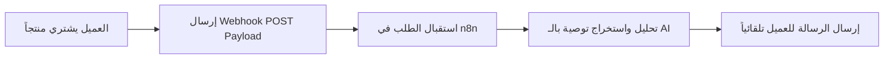

# ربط متجرك أو موقعك بنماذج الذكاء الاصطناعي عبر Webhooks مجاناً وبدون برمجة معقدة

تعد الـ **Webhooks** الرمز السحري للربط اللحظي بين الأنظمة البرمجية المختلفة على شبكة الإنترنت. عندما يملأ مستخدم نموذج اتصال على موقعك، أو يشتري عميل منتجاً من متجرك الإلكتروني، تتيح لك الـ Webhooks إرسال إشعار فوري في نفس الثانية لمعالجتها بالذكاء الاصطناعي.

في هذا الشرح المبسط، ستتعلم كيف ترتبط أي منصة (Shopify, WooCommerce, WordPress, أو حتى موقع مخصص) بـ **n8n ونماذج AI** مجاناً، لتقديم خدمات استثنائية لعملائك بمجرد وقوع الحدث.

---

## كيف تعمل تقنية الـ Webhook مع الذكاء الاصطناعي؟

بدلاً من فحص المتجر باستمرار بحثاً عن الطلبات الجديدة (الذي يستهلك الموارد والباندويث)، تقوم تقنية الـ Webhook بـ **Push Data**؛ أي إرسال البيانات المحددة فور حدوث التفاعل!



---

## الخطوة 1: إنشاء رابط الـ Webhook في n8n

1. افتح منصة n8n وأضف عقدة **Webhook Trigger**.
2. حدد طريقة الاستقبال لتكون `HTTP POST`.
3. احفظ الرابط الافتراضي المستخرج كـ Test URL و Production URL.

---

## الخطوة 2: ربط الرابط في متجرك أو النموذج الخاص بك

سواء كنت تستخدم WooCommerce أو Shopify أو نموذج Typeform:

- اذهب لصفحة الإعدادات -> الإشعارات والـ Webhooks.
- اختر الحدث: **Order Created** أو **Form Submitted**.
- ضع رابط الـ Webhook المولد من n8n.

## فيديو الشرح التطبيقي لربط الـ Webhooks

شاهد في هذا الفيديو التطبيقي كيفية إرسال الـ Webhooks من المتجر ومعالجتها لحظياً:

@[youtube](https://www.youtube.com/watch?v=n6DqZ-P7c2s)

---

## الخطوة 3: معالجة واستخراج البيانات بواسطة الذكاء الاصطناعي

عندما يصل حمولة الطلب (Payload) بأسلوب JSON، يحتوي عادة على بيانات مثل اسم العميل، العنوان، والمنتجات المطلوبة:

```json
{
  "customer_name": "أحمد علي",
  "order_id": "10492",
  "items": ["دورة أتمتة n8n المحترفة"],
  "total": "49$"
}
```

استخدم نود الـ AI وصغ الـ Prompt الآتي لتوليد رسالة شكر وتوجيه مخصصة باسم العميل:

> "أنت مسؤول المبيعات في الأكاديمية. صغ رسالة ترحيبية قصيرة عبر الواتساب للعميل أحمد الذي اشترك للتو في دورة أتمتة n8n وتمنى له تجربة تعليمية ممتعة."

---

## الخطوة 4: التجاوب التلقائي وإرسال النتيجة

بعد صياغة الرسالة الذكية، قم بتمرير الناتج إلى نود إرسال البريد الإلكتروني (Gmail Node) أو نود التليجرام/الواتساب لتصل للعميل فوراً خلال 3 ثوانٍ فقط من إتمامه للطلب!

---

## سيناريوهات مجانية مذهلة لاستخدام الـ Webhooks

1. **اكتشاف الطلبات المشبوهة أو الاحتيالية**: تحليل بيانات المشتري بذكاء اصطناعي وتنبيه الإدارة في حال وجود عناوين غريبة.
2. **الرد الفوري على طلبات التسعير**: قراءة متطلبات العميل من نموذج الاتصال وإرسال عرض سعر مبسط مبدئي آلياً.
3. **متابعة تقييمات وتجارب العملاء**: إرسال استبيان تقييم آلي بعد 3 أيام من تسليم المنتج.

---

## أسئلة شائعة (FAQ)

### هل يتطلب إنشاء الـ Webhook خبرة برمجية معقدة؟

إطلاقاً! منصات إدارة المتاجر مثل WooCommerce وShopify توفر واجهة بسيطة تلصق فيها الرابط وتختار الحدث بضغطات زر معدودة.

### ما الفرق بين الـ API والـ Webhook؟

الـ API يُستخدم عندما تطلب أنت المعلومات من السيرفر (Pull)، أما الـ Webhook فيقوم السيرفر بإرسال المعلومات إليك فوراً بمجرد حدوث التغير (Push).

### هل يمكنني تشغيل الـ Webhooks مجاناً للأبد؟

نعم! تشغيل الـ Webhooks عبر n8n أو Cloudflare Workers مجاني تماماً ولا يتطلب أي رسوم شهريّة.
