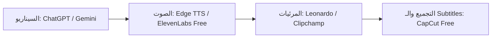

# إنشاء فيديوهات احترافية كاملة بالذكاء الاصطناعي مجاناً وبدون علامة مائية (دليل 2026)

أصبحت صناعة محتوى الفيديو على يوتيوب وتيك توك وإنستغرام ريلز واحدة من مربح المهارات الرقمية في الوقت الحالي. لكن العقبة الكبرى التي تمنع الكثيرين هي: تكلفة المعدات، صعوبة الوقوف أمام الكاميرا، أو العلامات المائية المزعجة التي تفرضها أدوات الذكاء الاصطناعي المدفوعة.

في هذا الدليل العملي، سأشارك معك خطة دمج مجانية 100% تمكنك من صناعة فيديو كامل بصوت واقعي بشرّي، وصور عالية الدقة، ونصوص متحركة (Subtitles) وبدون دفع دولار واحد أو ترك علامة مائية!

---

## سير عمل خط إنتاج الفيديو المجاني (AI Video Pipeline)



---

## الخطوة 1: كتابة سيناريو مقنع وجذاب (Script Generation)

افتح منصة **Google AI Studio** أو **ChatGPT** واطلب منه كتابة سيناريو مخصص للفيديوهات القصيرة (Shorts/Reels) باستخدام الصيغة التالية:

> "اكتب سيناريو فيديو قصير مدته 45 ثانية حول أسرار توفير المال في الذكاء الاصطناعي. استخدم أسلوباً مشوقاً في أول 3 ثوانٍ (Hook)، متبوعاً بنقاط سريعة ومختصرة باللغة العربية الفصيحة المبسطة."

---

## الخطوة 2: توليد التعليق الصوتي الواقعي مجاناً (Text-to-Speech)

للحصول على صوت بشري طبيعي جداً باللغة العربية وبدون علامة مائية أو قيود رسومية:

### استخدام أداة Microsoft Edge TTS المجانية:
تستخدم هذه الأداة أفضل الأصوات البشرية السحابية من مايكروسوفت (مثل صوت سلمى وحسني) وهي مجانية تماماً ومتاحة للتحميل بصيغة MP3 بدقة عالية عبر سكريبت Python بسيط أو إضافات المتصفح.

```python
# توليد التعليق الصوتي العربي مجاناً باستخدام edge-tts
import asyncio
import edge_tts

TEXT = "أهلاً بكم في أكاديمية بوعدة! اليوم سنتعلم أسرار الذكاء الاصطناعي مجاناً."
VOICE = "ar-EG-SalmaNeural"

async def main():
    communicate = edge_tts.Communicate(TEXT, VOICE)
    await communicate.save("output.mp3")

asyncio.run(main())
```

## فيديو الشرح المرئي الكامل لخطوات التعديل والتجميع

شاهد الشرح الكامل في الفيديو أدناه للتوليد البصري وإضافة الأصوات البشرية تلقائياً:

@[youtube](https://www.youtube.com/watch?v=p4vW7qB1pSg)

---

## الخطوة 3: توليد المشاهد واللقاطات المذهلة (Visual Assets)

للحصول على مشاهد وصور عالية الجودة تتوافق مع كلام التعليق الصوتي:

1. **Leonardo.ai**: يمنحك 150 رصيد يومي مجاني لتوليد صور بجودة سينمائية فائقة بدون علامات مائية على الصورة الرئيسية.
2. **Pexels & Pixabay Videos**: مكتبات مجانية تحتوي على ملايين الفيديوهات عالية الدقة (4K Stock Footage) المتاحة للاستخدام التجاري.
3. **Luma Dream Machine / Runway Free Tier**: لتوليد مشاهد متحركة بالذكاء الاصطناعي من الصور الساكنة.

---

## الخطوة 4: التجميع التلقائي والتصدير بـ 4K (CapCut / Clipchamp)

استخدم برنامج **CapCut (النسخة المجانية)** أو **Microsoft Clipchamp**:
* ارفع التعليق الصوتي واللقطات.
* قسّم المشاهد لتتغير كل 2 إلى 3 ثوانٍ للحفاظ على انتباه القارئ.
* فعّل ميزة **Auto Captions** المجانية لإضافة نصوص متحركة بأسلوب تيك توك الشهير.
* قم بتصدير الفيديو بدقة 1080p أو 4K **بدون أي علامة مائية**!

---

## جدول أدوات إنتاج الفيديو المجانية 2026

| المرحلة | الأداة المجانية | الميزة الفريدة |
| :--- | :--- | :--- |
| **السيناريو** | Google AI Studio | نافذة توكن ضخمة وكتابة سريعة |
| **التعليق الصوتي** | Edge TTS / ElevenLabs | صوت عربي طبيعي بدون أخطاء |
| **الصور والمرئيات** | Leonardo.ai + Pexels | توليد صور 4K مجاني |
| **الترجمة والتحرير** | CapCut / Clipchamp | إضافة Subtitles وتصدير بدون علامة مائية |

---

## أسئلة شائعة (FAQ)

### هل يحق لي تحقيق الأرباح (Monetization) من هذه الفيديوهات على يوتيوب؟
نعم! طالما أن المحتوى يحتوي على قيمة مضافة، وسيناريو مخصص، وصوت محسّن وتعديل بصري ممتاز، فإن يوتيوب يقبل الفيديوهات لتحقيق الأرباح دون مشاكل.

### ما هو طول الفيديو المثالي للفيديوهات القصيرة (Shorts)؟
أفضل طول يتراوح بين 30 إلى 50 ثانية مع التركيز الشديد على أول 3 ثوانٍ لجذب انتباه المشاهد وإكمال الفيديو للنهاية.

### هل يمكنني تشغيل هذا النظام بشكل آلي بالكامل؟
نعم، يمكنك ربط n8n مع Edge TTS وCanvas لإنتاج الفيديوهات ونشرها تلقائياً على قناتك عبر واجهات برمجة التطبيقات (APIs).
