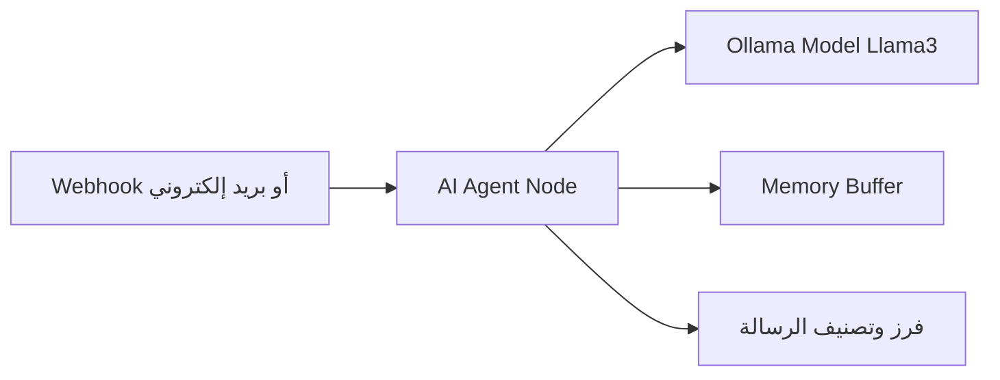

# كيفية ربط Ollama مع n8n لبناء أتمتة محلية بالذكاء الاصطناعي

تعتبر أتمتة المهام باستخدام الذكاء الاصطناعي واحدة من أقوى المهارات التي يمكن للمطورين وأصحاب الأعمال تعلمها اليوم. ولكن، غالباً ما تصطدم هذه الحلول بتكلفة الاستخدام المتكرر لواجهات برمجة التطبيقات (APIs) المدفوعة مثل OpenAI أو Claude، بالإضافة إلى مخاوف حماية خصوصية البيانات الحساسة.

هنا يأتي دور **Ollama** و **n8n**. فمن خلال ربطهما معاً، يمكنك بناء مساعدين أذكياء وأنظمة أتمتة متكاملة تعمل بالكامل على جهازك المحلي مجاناً وبأمان 100%. في هذا الدليل العملي، سنتعلم خطوة بخطوة كيفية إعداد البيئة المحلية وربط الأداتين معاً لبناء أول سير عمل ذكي خاص بك.

---

## ما هو Ollama وما هو n8n؟

- **Ollama**: هي أداة مفتوحة المصدر تتيح لك تشغيل نماذج لغوية ضخمة (LLMs) مثل Llama 3 و Mistral و DeepSeek محلياً على جهاز الكمبيوتر الخاص بك بسهولة ودون تعقيد.
- **n8n**: هي منصة أتمتة سير عمل قوية (Workflow Automation) تدعم البرمجة المرئية وتتيح لك ربط مئات الخدمات البرمجية وتصميم تدفقات عمل معقدة تدعم الذكاء الاصطناعي من خلال واجهة مستخدم مرنة ومفتوحة المصدر.

---

## المتطلبات الأساسية

قبل البدء، تأكد من توفر المتطلبات التالية على جهازك:
1. **جهاز كمبيوتر** بمواصفات جيدة (يُفضل وجود بطاقة رسوميات GPU من Nvidia بسعة 6 جيجابايت VRAM أو معالجات Apple Silicon لضمان سرعة الاستجابة).
2. تثبيت **Docker** (موصى به لتشغيل n8n بسهولة) أو بيئة Node.js.
3. اتصال بالإنترنت لتحميل النماذج لأول مرة فقط.

---

## الخطوة 1: تشغيل وتجهيز Ollama محلياً

1. قم بتحميل وتثبيت Ollama من الموقع الرسمي [ollama.com](https://ollama.com).
2. افتح مبدل الأوامر (Terminal أو PowerShell) وقم بتحميل وتشغيل نموذج لغوي مناسب لجهازك. على سبيل المثال، سنستخدم نموذج **Llama 3** (بحجم 8B وهو يحتاج على الأقل لـ 8 جيجابايت من الذاكرة العشوائية RAM):
   ```bash
   ollama run llama3
   ```
3. انتظر حتى يكتمل تحميل النموذج وتأكد من عمله بكتابة أي سؤال تجريبي في السطر البرمجي.
4. تأكد من أن منفذ خادم Ollama الافتراضي (`11434`) مفتوح ويعمل عن طريق زيارة الرابط التالي في متصفحك: `http://localhost:11434/` - يجب أن تظهر لك رسالة: `"Ollama is running"`.

---

## الخطوة 2: تشغيل وتجهيز n8n عبر Docker

الخيار الأفضل لتشغيل n8n وجعله قادراً على الوصول لخادم Ollama المحلي هو تشغيله باستخدام Docker. افتح سطر الأوامر واكتب الأمر التالي:

```bash
docker run -d --name n8n -p 5678:5678 -e N8N_ENFORCE_SETTINGS_FILE_PERMISSIONS=true n8nio/n8n
```

بعد اكتمال التشغيل، يمكنك فتح واجهة n8n عبر المتصفح بالانتقال إلى الرابط: `http://localhost:5678/`. قم بإنشاء حسابك الأول لتصل إلى لوحة التحكم.

> [!IMPORTANT]
> **ملاحظة شبكية هامة**: إذا كان n8n يعمل داخل حاوية Docker، فإن استخدام العنوان `localhost` أو `127.0.0.1` للإشارة إلى Ollama سيشير إلى الحاوية نفسها وليس لجهازك الأساسي. للوصول لجهازك الأساسي الذي يعمل عليه Ollama، يجب استخدام عنوان المضيف الخاص بـ Docker وهو:
> **`http://host.docker.internal:11434`** لنظامي Windows و Mac.

---

## الخطوة 3: ربط Ollama بـ n8n باستخدام العقد الذكية (AI Nodes)

يدعم n8n ميزات متقدمة لبناء وكلاء ذكاء اصطناعي (Advanced AI). لإنشاء أول ربط:

1. انقر على **Create New Workflow** في n8n.
2. أضف عقدة **AI Agent** أو **Basic LLM Chain** إلى مساحة العمل.
3. داخل عقدة الـ Agent، ستلاحظ وجود منفذ لـ **Model**، انقر على علامة (+) بجانبه للبحث عن نموذج لغوي.
4. ابحث عن **Ollama** واختر **Model Ollama**.
5. سيطلب منك إنشاء اتصال جديد (Credentials)، انقر على **Create New Credential** واملأ البيانات كالتالي:
   - **Base URL**: أدخل العنوان `http://host.docker.internal:11434` (أو `http://localhost:11434` إذا كنت لا تستخدم Docker لتشغيل n8n).
6. احفظ الاتصال، وفي خانة **Model Name** في العقدة اكتب اسم النموذج اللغوي الذي قمت بتحميله في Ollama تماماً (على سبيل المثال: `llama3`).

---

## الخطوة 4: بناء أول تدفق عمل ذكي (مثال عملي لفرز المهام)

لنقم ببناء سير عمل بسيط يقوم باستقبال رسالة بريد إلكتروني وتصنيفها كـ (هام) أو (عادي) تلقائياً:



### خطوات البناء:
1. أضف عقدة **Manual Trigger** في البداية لتجربة الأتمتة يدوياً.
2. اربطها بعقدة **AI Agent**.
3. قم بتوصيل نموذج **Ollama** الذي أعددناه في الخطوة 3 بعقدة الـ Agent.
4. أضف عقدة **Window Buffer Memory** إلى منفذ الذاكرة الخاص بالـ Agent لتمكينه من تذكر سياق المحادثة.
5. في حقل **System Prompt** الخاص بالـ Agent، اكتب التعليمات التالية باللغة العربية:
   ```text
   أنت مساعد ذكي متخصص في إدارة رسائل البريد الإلكتروني. وظيفتك هي قراءة نص الرسالة وتحديد تصنيفها من بين الخيارين التاليين فقط: [هام] أو [غير هام].
   أعد النتيجة في كلمة واحدة فقط دون أي شروحات إضافية.
   ```
6. انقر على **Test Step** وأدخل رسالة تجريبية مثل: "عاجل: يرجى مراجعة فواتير الشهر الحالي وإرسال التقرير قبل الغد".
7. ستلاحظ قيام Ollama بمعالجة الطلب محلياً بالكامل وإرجاع النتيجة `[هام]` لـ n8n بنجاح.

---

## الأخطاء الشائعة وحلولها

### 1. خطأ `Connection Refused` أو `Failed to fetch`
* **السبب**: عدم قدرة n8n على الوصول لـ Ollama بسبب إعدادات الشبكة في Docker أو جدار الحماية.
* **الحل**: تأكد من تعيين المتغير البيئي لـ Ollama ليقبل الاتصالات الخارجية. على نظام تشغيل Windows/Mac تأكد من إغلاق وتحديث Ollama وتعيين العنوان `OLLAMA_HOST=0.0.0.0` في متغيرات البيئة للجهاز، واستخدام `http://host.docker.internal:11434` داخل n8n.

### 2. بطء شديد في توليد النصوص واستجابة النموذج
* **السبب**: معالجة النموذج تتم على المعالج الأساسي CPU لعدم توفر GPU أو صغر سعة كرت الشاشة.
* **الحل**: استخدم نماذج ذات حجم أصغر ومحسنة للعمل المحلي مثل `Phi-3` من مايكروسوفت (3.8B) أو `Gemma 2` (2B) والتي توفر أداءً ممتازاً وسريعاً على الأجهزة المتوسطة:
  ```bash
  ollama run gemma2:2b
  ```

---

## أفضل الممارسات لتحسين الأداء (Best Practices)

- **اختيار النموذج المناسب**: لا تستخدم نماذج أكبر من قدرة جهازك (قاعدة عامة: تحتاج إلى 1 جيجابايت VRAM لكل 1 مليار بارامتر في النموذج).
- **أمن الشبكة**: لا تقم بفتح منفذ Ollama `11434` للإنترنت الخارجي دون وضع جدار حماية أو نظام مصادقة (Reverse Proxy مع Basic Auth) لحماية موارد جهازك.
- **تحديد حجم السياق (Context Window)**: تذكر تحديد حدود الذاكرة وعدد التوكنز المستهلكة في n8n حتى لا تتجاوز قدرة المعالجة المحلية لجهازك وتتسبب في إيقاف البرنامج.

---

## خاتمة

ربط Ollama مع n8n هو البوابة الذهبية لبناء برامج ذكاء اصطناعي سيادية وخاصة بك بالكامل دون أي ارتباط بخوادم خارجية أو اشتراكات شهرية مكلفة. يمكنك الآن تطوير هذه الشبكة لربطها ببريد إلكتروني حقيقي، أو تيليجرام، أو جداول بيانات لتحويل أفكارك إلى حقيقة.

---

## الأسئلة الشائعة (FAQ)

### هل يمكنني استخدام نماذج ذكاء اصطناعي تدعم اللغة العربية بشكل جيد؟
نعم، نماذج مثل **Llama 3** و **Gemma 2** تدعم اللغة العربية بشكل مقبول جداً. كما يمكنك تجربة النماذج المخصصة للغة العربية أو النماذج العامة مثل **DeepSeek-R1** للغات المتعددة.

### هل يعمل هذا النظام بدون اتصال بالإنترنت تماماً؟
نعم، بعد قيامك بتحميل النموذج لأول مرة عبر أمر `ollama run` وتثبيت حاويات Docker، يمكنك فصل الإنترنت عن جهازك بالكامل وسيعمل النظام بكفاءة تامة.

### كم عدد النماذج التي يمكنني تشغيلها في وقت واحد؟
يعتمد ذلك على حجم ذاكرة الرسوميات (VRAM) المتوفرة لديك. يقوم Ollama تلقائيًا بإلغاء تحميل النماذج غير النشطة من الذاكرة لتوفير المساحة للنماذج الجديدة، ولكن يفضل تشغيل نموذج واحد نشط في سير العمل لضمان استقرار وسرعة الأداء.

### هل يمكنني تشغيل نماذج البرمجة والأكواد؟
بالتأكيد، يمكنك تحميل نماذج متخصصة في الأكواد مثل `DeepSeek-Coder` أو `CodeLlama` واستخدامها داخل n8n لأتمتة كتابة الأكواد أو إصلاح الثغرات ومراجعة برمجياتك تلقائياً.
